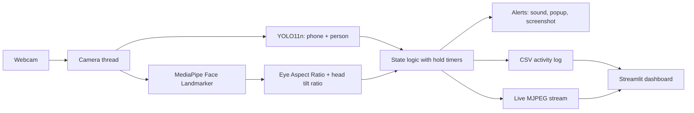

# 🎯 FocusGuard AI

**An AI-based student focus monitoring system that uses a webcam to detect phone use, sleeping and absence, and alerts the student in real time.**

> 📸 *Add a screenshot here:* ``
>
> 🎥 *Add your demo video link here*

---

## What is FocusGuard AI?

FocusGuard AI is a study-assistant application that watches a student through an ordinary laptop webcam and works out what they are doing: **studying, looking at the screen, using a mobile phone, sleeping, or away from the desk**.

When it notices a distraction, it responds straight away with a sound of your choice, a popup message and a saved screenshot. Every activity is also written to a log, so a web dashboard can show how much time was really spent focused.

It is built with two pretrained deep-learning models (YOLO for objects, MediaPipe for the face) and a set of simple rules on top, and everything runs **locally on the CPU** of a normal laptop. No video is uploaded anywhere.

## The problem it solves

Most students study alone with a phone within reach. A few minutes of scrolling quietly turns into half an hour, and long sessions often end with the student dozing off. Nobody notices while it is happening, and phone-blocking apps cannot tell what the student is physically doing.

FocusGuard AI fixes this by looking at the student instead of the device. It tells you **at the moment** you drift, and shows you **afterwards** how your time was spent.

## What it detects

| Situation | How it is recognised | Response |
|---|---|---|
| 📱 Using mobile | YOLO sees a phone in the frame for about 2 seconds | Sound, popup, screenshot |
| 😴 Sleeping | Eyes stay closed (Eye Aspect Ratio below a threshold) | Sound, popup, screenshot |
| 👤 Not present | No person and no face in view for about 8 seconds | Beep and popup |
| 📖 Studying | Head tilted down with eyes open | None, counted as focused time |
| 💻 Looking at screen | Face visible and facing forward | None, counted as focused time |

## How it works



1. **Capture:** a background thread always holds the newest 640 × 480 frame, so video never lags.
2. **Detect:** YOLO11n finds phones and people. MediaPipe Face Landmarker finds the eyes, nose, forehead and chin.
3. **Measure:** the Eye Aspect Ratio (EAR) shows whether the eyes are open. A nose-to-chin ratio shows whether the head is tilted down.
4. **Decide:** a state must last a few seconds before it counts. This removes false alarms from blinks and missed frames.
5. **Respond:** play the chosen sound, show a popup, save a screenshot and log the event.
6. **Review:** the web app shows live video, a focus score, charts and a daily goal.

## Features

- Live camera view inside the browser
- Different sound, loop mode and popup message for each alert
- Upload your own mp3, wav or ogg alert sounds
- **Calibration wizard** that sets thresholds for your face and camera angle
- **Pomodoro timer** (focus and break cycles); alerts pause during breaks
- Daily study goal with a progress bar
- Dashboard: focus score, time per activity, activity by hour, focus score by day, most focused hour
- CSV log export and a printable HTML report
- Screenshot gallery with delete buttons
- Privacy mode that hides the video while detection keeps running
- Everything runs locally; no cloud, no GPU needed

## Tech stack

Python · OpenCV · Ultralytics YOLO11 · MediaPipe Face Landmarker · Streamlit · Pandas · NumPy · Pygame · Plyer

## Project structure

```
FocusGuard_AI/
├── alerts/            # alert sounds (mp3 / wav / ogg)
├── models/            # yolo11n.pt and face_landmarker.task
├── logs/              # activity_log.csv (created automatically)
├── screenshots/       # alert snapshots (created automatically)
├── app.py             # Streamlit web app (the frontend)
├── main_v5.py         # detection engine (the monitor)
├── config.py          # shared paths and default settings
├── player.py          # plays alert sounds
├── index.html         # project landing page (GitHub Pages)
├── requirement.txt
├── .gitignore
└── README.md
```

## Installation

You need Python 3 and a webcam. It was developed and tested on Windows.

```bash
git clone https://github.com/Raman-yadav17/FocusGuard-AI.git
cd FocusGuard-AI
pip install -r requirement.txt
```

1. Put `yolo11n.pt` inside the `models/` folder.
2. The face model (`face_landmarker.task`) downloads itself on the first run.
3. Put at least one sound file in `alerts/`.

## How to run

```bash
python -m streamlit run app.py
```

1. Press **▶ Start** in the sidebar and wait for the models to load.
2. Open the **Calibrate** tab once and follow the four short steps.
3. Study as usual. Open the **Live** tab to watch, or the **Dashboard** tab to see your stats.
4. Press **⏹ Stop** when you finish. The session is saved to the log.

## Calibration

Detection depends on camera angle, lighting and each person's face. The **Calibrate** tab records four short samples (looking at the screen, looking down, eyes open, eyes closed), takes the median of each, and sets the head-down and eye-closed thresholds halfway between them. This is a quick way to improve accuracy for each user.

## Machine learning in this project

- **Object detection:** pretrained YOLO11n (COCO dataset) detects `cell phone` and `person`.
- **Facial landmark detection:** pretrained MediaPipe Face Landmarker gives 478 face points.
- **Feature engineering:** Eye Aspect Ratio and head-tilt ratio are calculated from the landmarks.
- **Temporal filtering:** hold timers make decisions over seconds instead of single frames.
- **Rule-based classification** turns those features into the five student states.

The models are pretrained and were not trained by me. The project's own work is the feature design, the timing rules, the calibration, the alerts and the web app.

## Privacy

All video is processed on your own computer and is never recorded or uploaded. The only images saved are the alert screenshots in `screenshots/`, which you can delete from the app. Use it only with the knowledge and consent of the person being monitored.

## Limitations

- A phone is only detected when the camera can see it.
- Accuracy depends on lighting, camera position and glasses.
- Studying versus looking at the screen is estimated from a 2D head-tilt ratio, so it needs calibration.
- It is rule-based on top of pretrained models, not a classifier trained on custom data.
- It monitors one student at a time.

## Test results

*Fill this in with your own measured results.*

| Behaviour | Trials | Correct | Accuracy |
|---|---|---|---|
| Using mobile | | | |
| Sleeping | | | |
| Studying | | | |
| Looking at screen | | | |
| Not present | | | |

## Future work

- Train a custom classifier on labelled data from the activity log
- Real head-pitch estimation from the face transformation matrix
- Detect a hand holding a phone, even when the phone is hidden
- Telegram or email alerts for parents or mentors
- Multiple student profiles and weekly summaries

## Author

**Raman Yadav**
